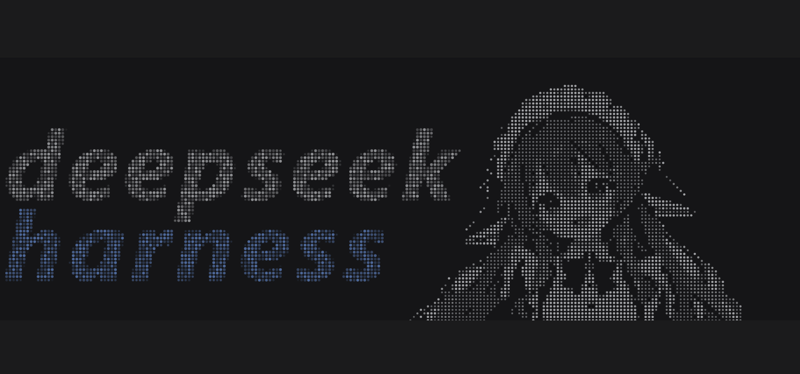

# DeepClear UI



A quiet dot-matrix theme for DeepSeek Harness (dsh). Fixed dots, native dsh surfaces,
whale-blue accents and purposeful motion. Distributed as a normal dsh plugin bundle.

## Version 1.8.1

- **Reading**: calmer paragraph rhythm, headings, quotes and inline code; respects your font size.
- **Code**: muted syntax colours; blue additions and warm deletions retain syntax highlighting.
- **Welcome**: the original portrait, wordmark and phase-aligned dot lattice. Dots stay fixed;
  only brightness changes. Dark uses the line-art grid; light uses the ink grid.
- **Status**: a small additive dot sphere; the original dsh status text and real elapsed time remain visible.
- **Composer**: restrained glass, a dot floor, a brief focus transition and compact usage figures.
  Other plugins and host controls remain visible, including the built-in usage meter.

All 14 features can be switched independently. Reduced-motion preferences stop the artwork
and sphere animation; hidden tabs stop their animation loops.

The instrument interface experiment and global light/dark palette have been removed.
Navigation, control geometry and surface colours use native dsh styling.

## Settings

Open **DeepClear UI** in the sidebar footer or its configuration page in Plugins.
Changes apply immediately and save automatically in the active **dsh profile**.
The two entry points share the same settings. Read-only or unavailable settings are disabled;
failed saves are shown explicitly. Escape closes the sheet and returns keyboard focus.

The theme’s **Reset to defaults** keeps the migration marker. Manually deleting the whole
Host namespace also deletes that marker, so a later load may import the legacy key again.

Upgrading from 1.7 imports valid legacy localStorage preferences only when the Host namespace
has no user preferences. The import is atomic and revision-checked; existing Host preferences
win. The old browser key is retained read-only because other profiles may share the origin.

## Install

Install `deepclear-ui` from the dsh Plugins panel once this version is published.
For a local release archive, use dsh's package installation flow with `deepclear-ui-1.8.1.tgz`.
The archive built in this development round has **not** been published to npm or the marketplace.
After upgrading from the old client-only version, restart dsh once to load the Host settings schema.

Tested against installed dsh **0.2.2-rc.3**, using an isolated web profile and the real settings
transport. The declared range is `>=0.2.2-rc.3 <0.3.0`; other versions have not been verified.
The only runtime dependency is `@deepseek-ai/schemastery` for the Host settings schema.

## Plugin boundaries

No changes to dsh source files are required. The theme uses public Slots, theme-token layers,
semantic CSS markers and its own canvases/settings portal. Unloading removes its own layers,
classes and elements. ANSI terminal colours and host status timing are not replaced.
The optional sphere locates the running label through an internal class fragment; if that
changes it simply disappears while the original status remains available.

## Development

```sh
npm ci
npm run build
npm test
npm run check
npm pack --ignore-scripts
```

`npm run build` embeds the existing hero grids and the runtime/CSS sources without resampling
the illustration. See [design rules](docs/DESIGN.md), [plugin capability map](docs/PLUGIN-SURFACE.zh.md)
and [validation notes](docs/VALIDATION-1.8.zh.md). Artwork editing tools are documented in
[scripts/README.md](scripts/README.md) in the source repository.

## License

MIT. See [LICENSE](LICENSE).
